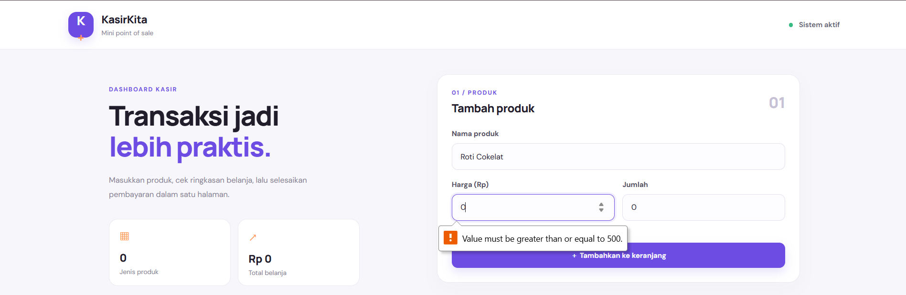
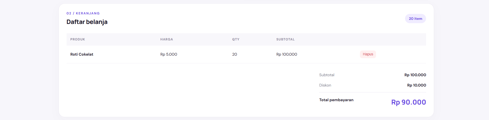
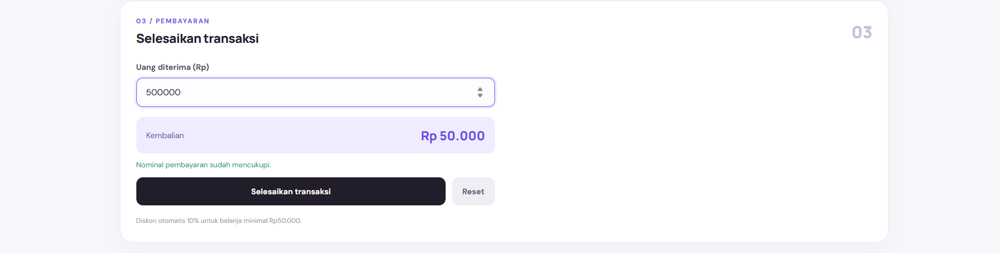

KASIRKITA — MINI POS

## 1. Identitas Mahasiswa

- Nama: Kevin Savero
- NIM: 124140143
- Kelas Praktikum: RA
- Mata Kuliah: Praktikum Pemrograman Web
- Pertemuan: 1

---

## 2. Deskripsi Proyek

Web ini ialah sebuah website kasir sederhana yang dirancang untuk membantu proses transaksi penjualan barang secara lebih praktis dan terstruktur. Website ini memungkinkan pengguna untuk memasukkan data produk berupa nama barang, harga satuan, dan jumlah barang yang dibeli.

Website ini dilengkapi dengan fitur keranjang belanja yang menampilkan daftar produk beserta harga, jumlah, dan subtotal setiap barang. Selain itu, website dapat menghitung total belanja secara otomatis, memberikan potongan harga sesuai ketentuan, serta menghitung uang kembalian berdasarkan nominal pembayaran yang dimasukkan.

Tampilan website dibuat menggunakan kombinasi warna ungu, putih, dan oranye dengan desain dashboard yang sederhana dan responsif. Website ini dibuat menggunakan HTML, CSS, dan JavaScript serta dapat dijalankan langsung melalui browser tanpa memerlukan backend maupun database.

Proyek ini bertujuan untuk menerapkan dasar-dasar pemrograman web, khususnya dalam pembuatan struktur halaman, pengaturan tampilan, validasi input, manipulasi elemen HTML, dan perhitungan transaksi menggunakan JavaScript.

---

## 3. Tujuan Pembuatan

Tujuan pembuatan website ini adalah:

1. Menerapkan penggunaan HTML untuk membangun struktur halaman web.
2. Menggunakan CSS untuk mengatur tampilan dan tata letak website.
3. Mengimplementasikan JavaScript untuk memproses data dan melakukan perhitungan transaksi.
4. Membuat validasi input agar data produk yang dimasukkan sesuai dengan ketentuan.
5. Menerapkan perhitungan subtotal, diskon, total pembayaran, dan kembalian secara otomatis.
6. Membuat halaman kasir yang mudah digunakan dan dapat menyesuaikan tampilan pada berbagai ukuran layar.

---

## 4. Struktur File Proyek

Berikut adalah struktur file yang digunakan dalam proyek ini:

Alternatif_Mini_POS_Kasir/
index.html
style.css
script.js
README.md
screenshots/
modul/

Keterangan:

- "index.html" digunakan untuk menyusun struktur halaman website, form input produk, tabel keranjang, dan bagian pembayaran.
- "style.css" digunakan untuk mengatur desain visual, warna, jarak, tata letak, dan tampilan responsif.
- "script.js" berisi logika program untuk validasi input, pengelolaan keranjang, perhitungan transaksi, dan proses pembayaran.
- "README.md" berisi dokumentasi mengenai proyek, fitur, cara menjalankan website, dan penjelasan teknis.
- "screenshots/" digunakan untuk menyimpan dokumentasi berupa tangkapan layar hasil pengujian website.
- "modul/" disediakan sebagai folder untuk menyimpan file latihan atau materi praktikum.

---

## 5. Fitur Website

5.1 Input Data Produk

Pengguna dapat memasukkan nama produk, harga satuan, dan jumlah barang melalui form yang tersedia. Data tersebut digunakan untuk menghitung nilai belanja setiap produk.

5.2 Validasi Input

Website memeriksa data yang dimasukkan sebelum produk ditambahkan ke keranjang. Validasi dilakukan untuk memastikan nama produk memiliki minimal tiga karakter, harga berupa bilangan bulat minimal Rp500, dan jumlah barang berupa bilangan bulat minimal satu.

Jika data tidak memenuhi ketentuan, website akan menampilkan pesan kesalahan dan mencegah data tersebut masuk ke keranjang.

5.3 Keranjang Belanja

Setiap produk yang berhasil ditambahkan akan ditampilkan dalam tabel keranjang belanja. Tabel menampilkan nama produk, harga satuan, jumlah barang, subtotal, dan tombol untuk menghapus produk.

5.4 Perhitungan Subtotal

Website menghitung subtotal setiap produk berdasarkan harga satuan dikalikan dengan jumlah barang yang dibeli.

5.5 Perhitungan Total Belanja

Total belanja dihitung dari penjumlahan seluruh subtotal produk yang berada di keranjang, kemudian dikurangi dengan diskon apabila memenuhi ketentuan.

5.6 Diskon Otomatis

Website memberikan diskon sebesar 10% apabila subtotal belanja mencapai minimal Rp50.000. Jika subtotal belum mencapai jumlah tersebut, diskon yang diberikan adalah Rp0.

5.7 Pembayaran dan Kembalian

Pengguna dapat memasukkan nominal uang yang diterima dari pembeli. Website kemudian membandingkan nominal tersebut dengan total pembayaran dan menampilkan jumlah kembalian jika uang mencukupi.

Jika nominal pembayaran kurang dari total belanja, website akan menampilkan pesan bahwa pembayaran belum mencukupi.

5.8 Penyelesaian Transaksi

Tombol penyelesaian transaksi digunakan untuk memeriksa apakah terdapat produk dalam keranjang dan apakah nominal pembayaran sudah mencukupi. Jika seluruh ketentuan terpenuhi, website menampilkan notifikasi transaksi berhasil dan mengosongkan keranjang untuk transaksi berikutnya.

5.9 Reset Transaksi

Fitur reset digunakan untuk mengosongkan keranjang, membersihkan form input, menghapus nominal pembayaran, dan mengembalikan tampilan ke kondisi awal.

5.10 Tampilan Responsif

Website menggunakan CSS responsif agar tata letak dapat menyesuaikan ukuran layar. Dengan demikian, halaman tetap dapat digunakan melalui laptop maupun perangkat dengan layar yang lebih kecil.

---

## 6. Cara Menjalankan Website

Website dapat dijalankan secara langsung melalui browser karena tidak membutuhkan backend maupun database.

Langkah-langkah menjalankan website:

1. Unduh atau clone repository GitHub yang berisi proyek ini.
2. Ekstrak file apabila proyek diunduh dalam format ZIP.
3. Buka folder proyek.
4. Pastikan file "index.html", "style.css", dan "script.js" berada pada lokasi yang sesuai.
5. Klik dua kali file "index.html".
6. Website akan terbuka di browser dan siap digunakan.

Untuk mencoba fitur website, masukkan nama produk, harga satuan, dan jumlah barang. Setelah itu, tambahkan produk ke keranjang, periksa hasil perhitungan, masukkan nominal pembayaran, lalu coba selesaikan transaksi.

---

## 7. Screenshot Aplikasi

---

## 8. Penjelasan Teknis

8.1 HTML

HTML digunakan untuk membangun struktur utama halaman website. Elemen HTML mencakup bagian header, informasi dashboard, form input produk, tabel keranjang belanja, ringkasan total, form pembayaran, dan tombol tindakan.

Setiap bagian disusun agar pengguna dapat memasukkan data dan melihat hasil transaksi dalam satu halaman.

8.2 CSS

CSS digunakan untuk mengatur tampilan website, termasuk kombinasi warna ungu, putih, dan oranye, bentuk kartu, desain tombol, tabel, form input, serta jarak antarbagian.

CSS juga digunakan untuk mengatur tata letak responsif melalui media query agar tampilan website dapat menyesuaikan ukuran layar perangkat.

8.3 JavaScript

JavaScript digunakan untuk menjalankan fungsi utama website, seperti membaca input pengguna, melakukan validasi, menambahkan produk ke keranjang, menghapus produk, menghitung subtotal dan total belanja, memberikan diskon, serta menghitung kembalian.

JavaScript juga menangani tombol penyelesaian transaksi dan reset agar perubahan data dapat langsung ditampilkan tanpa perlu memuat ulang halaman.

8.4 Validasi Input

Validasi dilakukan ketika pengguna mengirimkan form produk. Program memeriksa nama produk, harga, dan jumlah barang.

Ketentuan validasi yang diterapkan adalah:

- Nama produk minimal tiga karakter setelah spasi di awal dan akhir dihilangkan.
- Harga harus berupa bilangan bulat dengan nilai minimal Rp500.
- Jumlah barang harus berupa bilangan bulat minimal satu.

Apabila salah satu ketentuan tidak terpenuhi, program menampilkan pesan kesalahan dan tidak menambahkan produk ke keranjang.

8.5 Perhitungan Otomatis

Perhitungan subtotal menggunakan rumus:

Subtotal = Harga Satuan × Jumlah Barang

Total subtotal seluruh produk dihitung menggunakan penjumlahan setiap nilai subtotal.

Jika subtotal mencapai Rp50.000 atau lebih, diskon dihitung dengan rumus:

Diskon = 10% × Subtotal

Total pembayaran dihitung dengan rumus:

Total Pembayaran = Subtotal − Diskon

Kembalian dihitung menggunakan rumus:

Kembalian = Uang Diterima − Total Pembayaran

Perhitungan kembalian hanya dianggap mencukupi apabila nominal uang yang diterima sama dengan atau lebih besar daripada total pembayaran.

8.6 Pengelolaan Data Keranjang

Data produk yang ditambahkan dikelola menggunakan array JavaScript. Setiap produk menyimpan informasi berupa nama, harga, dan jumlah barang.

Ketika isi keranjang berubah, fungsi untuk menampilkan keranjang dijalankan kembali agar tabel, jumlah produk, subtotal, diskon, dan total pembayaran menyesuaikan data terbaru.

Data keranjang pada versi ini hanya disimpan sementara selama halaman digunakan dan belum menggunakan "localStorage". Oleh karena itu, data tidak ditujukan untuk penyimpanan permanen.

8.7 Penyelesaian Transaksi

Sebelum transaksi diselesaikan, program memeriksa apakah keranjang berisi produk dan apakah uang yang diterima mencukupi.

Jika pemeriksaan berhasil, website menampilkan notifikasi transaksi berhasil, mengosongkan keranjang, dan membersihkan input pembayaran. Jika pemeriksaan gagal, website menampilkan pesan yang sesuai.

---

## 9. Pengujian Fitur

Pengujian dilakukan untuk memastikan fitur utama website dapat berjalan sesuai dengan tujuan pembuatan.

No.| Fitur yang Diuji| Hasil yang Diharapkan
1| Input produk valid| Produk berhasil ditambahkan ke keranjang
2| Nama produk kurang dari 3 karakter| Pesan validasi ditampilkan
3| Harga kurang dari Rp500| Produk tidak ditambahkan
4| Jumlah barang kurang dari 1 atau bukan bilangan bulat| Pesan validasi ditampilkan
5| Menghapus produk| Produk terhapus dari keranjang
6| Menghitung subtotal| Subtotal sesuai harga dikalikan jumlah
7| Belanja minimal Rp50.000| Diskon 10% diterapkan
8| Pembayaran kurang| Pesan pembayaran belum mencukupi ditampilkan
9| Pembayaran mencukupi| Kembalian dihitung dengan benar
10| Menyelesaikan transaksi| Notifikasi berhasil ditampilkan dan keranjang dikosongkan
11| Reset transaksi| Form dan keranjang kembali ke kondisi awal

---

## 10. Kesimpulan

Pembuatan website Mini POS ini menjadi salah satu penerapan dasar pemrograman web menggunakan HTML, CSS, dan JavaScript. Website menyediakan fitur pengelolaan keranjang belanja, validasi data produk, perhitungan subtotal, pemberian diskon, serta penghitungan pembayaran dan kembalian secara otomatis.

Melalui proyek ini, konsep dasar pengembangan website dapat dipelajari melalui penerapan struktur HTML, desain CSS, pengolahan data menggunakan JavaScript, serta pengujian fungsi berdasarkan kebutuhan pengguna.

Website ini masih berupa proyek sederhana yang berjalan di browser dan dapat dikembangkan lebih lanjut dengan penambahan fitur penyimpanan transaksi, riwayat penjualan, maupun integrasi database pada pengembangan berikutnya.
